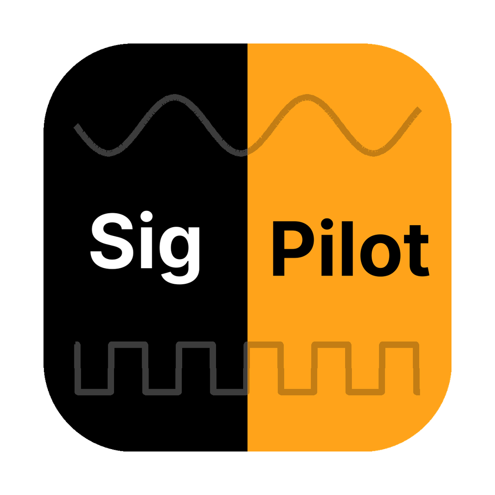
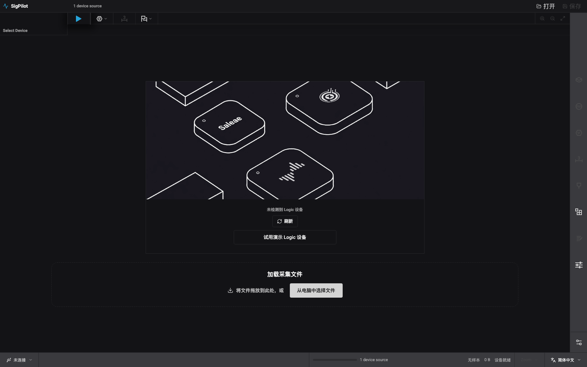
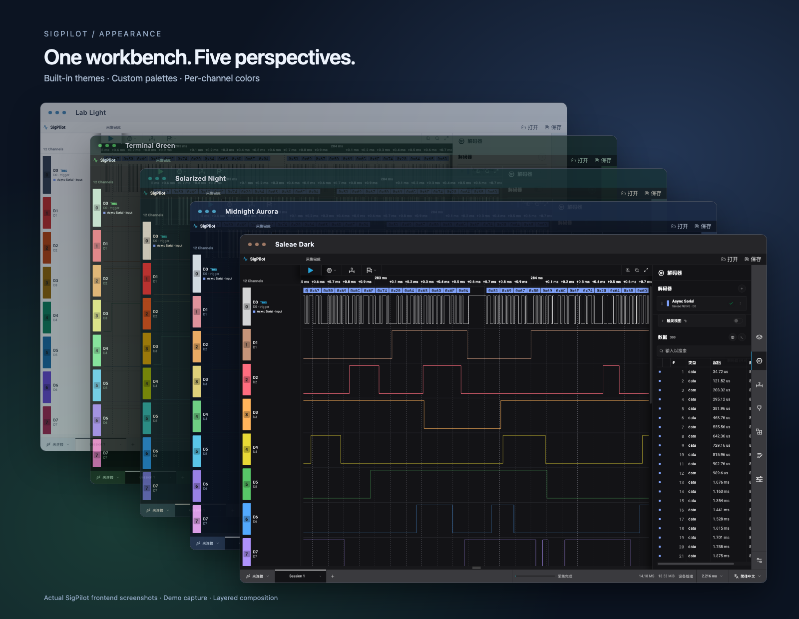

<p align="center">
  
</p>

<h1 align="center">SigPilot</h1>

<p align="center">
  为逻辑分析仪爱好者打造的跨平台信号分析工作台<br />
  <em>An independent desktop workbench for logic analyzers.</em>
</p>

<p align="center">
  <a href="https://github.com/listentodella/sigpilot/releases">下载</a> ·
  <a href="#快速体验">快速体验</a> ·
  <a href="#硬件与平台">硬件与平台</a> ·
  <a href="#参与共建">参与共建</a>
</p>



*首次打开、尚未连接硬件时的实际前端界面。可以选择演示设备开始体验，也可以加载已有采集文件。*

## 为什么做 SigPilot？

一台逻辑分析仪的价值，不只在于能采到信号，也在于能否快速找到问题：放大某个脉冲、读出一段串口通信、定位协议帧、比较时间间隔，再把采集与分析结果分享给别人。

SigPilot 希望把这些操作放在同一个桌面工作台里，并逐步让不同厂商的硬件共享这套体验。当前使用 **Tauri + React + Rust**：Rust 负责设备、采集和波形索引，前端负责交互，原生协议解码器在独立进程中运行。

项目仍在积极开发。欢迎嵌入式开发者、硬件爱好者和桌面应用开发者一起测试、修复和扩展。**没有硬件也可以通过演示设备体验界面，参与 UI、文档与测试。**

## 现在可以做什么？


*实际运行的 SigPilot 前端：演示设备生成串口数据，波形上的字节气泡与右侧结果表同步显示。截图来自浏览器演示模式，不是硬件采集，也不是设计稿。*

| 场景 | 当前能力 |
| --- | --- |
| 看波形 | 多通道数字波形、平移与缩放、通道排序和尺寸调整、边沿导航 |
| 读协议 | 解码气泡、结果表、搜索与跳转；串口、I²C、SPI、CAN 等协议后端 |
| 做测量 | 交互式测量、区间测量、时间标记与注释 |
| 保存与分享 | `.pxl` 工作区、`.pxcap` 采集文件、`.sr` / VCD 导出、截图与诊断日志 |
| 调整工作台 | 中文 / English、5 个内置主题、自定义主题与通道配色 |
| 无硬件试用 | 演示数字与模拟信号，按已配置解码器生成可分析的数据 |

模拟波形的演示支持不等于所有硬件都支持模拟采集；真实能力由设备驱动提供。

### 主题画廊



*由同一段演示采集的五张真实界面截图排版合成；透明度、圆角与阴影仅用于主题展示，不代表应用窗口本身的外观。*

内置 **Saleae Dark、Midnight Aurora、Solarized Night、Terminal Green、Lab Light**。查看 [主题介绍与五种完整界面预览](docs/ui-themes.md#主题预览)，了解各主题配色、自定义主题和逐通道颜色设置。


## 快速体验

### 使用发布包

1. 在 [Releases](https://github.com/listentodella/sigpilot/releases) 下载适合系统的产物，以该版本实际列出的文件为准。
2. Windows 解压便携 ZIP 后启动 `SigPilot.exe`。**保留旁边的 `resources` 目录**，不要只移动 exe。
3. 没有设备时，点击 **「试用演示 Logic 设备」**。
4. 添加一个 **Async Serial** 解码器，保留默认参数并保存，然后开始采集、停止。
5. 放大波形，查看解码气泡；在解码器侧栏打开数据表，尝试搜索和定位帧。

当前已发布的 `v1.0.3` 提供 Windows x64 便携包。工作流也面向 Linux x64、macOS Apple Silicon / Intel，但各平台构建和发布可能独立失败，**不能仅凭存在 CI 配置就认为该版本已有可用安装包**。查看 [Actions](https://github.com/listentodella/sigpilot/actions/workflows/build-cross-platform.yml) 可了解对应构建状态。

### 在浏览器中体验前端

需要 Node.js 22.13+ 和 pnpm 11.7.0：

```bash
git clone https://github.com/listentodella/sigpilot.git
cd sigpilot
pnpm install --frozen-lockfile
pnpm dev
```

打开终端显示的地址，默认是 `http://127.0.0.1:1420`。浏览器模式使用演示后端，可体验波形、解码结果与主题；**不提供原生 USB 采集或真实 sidecar 执行**。连接硬件请使用桌面应用。

## 硬件与平台

项目面向多种设备，但「能发现 USB 设备」「能准备设备」「能稳定采集」是不同的验证阶段。

| 设备 | 当前状态与要求 |
| --- | --- |
| 演示设备 | 无需硬件；适合先体验和开发界面 |
| PXLogic | 已接入准备与采集流程，Windows 已有实际使用验证；其他系统、板型和采集设置欢迎补充验证 |
| Kingst LA2016 / LA 系列 | 已有识别、固件准备与采集实现；需要用户提供匹配的 Kingst 固件，具体型号、板卡修订和系统组合仍需实测 |
| 其他逻辑分析仪 | 欢迎增加独立驱动和验证记录；不是所有 USB 逻辑分析仪都能即插即用 |

**连接前先退出厂商上位机和其他采集程序。** 例如 KingstVIS 占用 LA2016 时，SigPilot 可能发现设备但无法打开它。

- Windows：设备必须使用 libusb 可访问的驱动。只有排除程序占用后仍无法访问，才检查驱动绑定；更换厂商驱动可能影响原厂软件。
- Linux：检查 USB 权限与设备访问规则，以及是否有其他进程占用。
- PXLogic 所需 bitstream 随项目提供于 `resources/bitstreams`，许可证见 [原始说明](resources/bitstreams/LICENSE.txt)。
- Kingst 固件不随项目分发。将合法取得的匹配文件放在单独目录，并设置 `SIGPILOT_KINGST_FIRMWARE_DIR`。

```powershell
# Windows PowerShell：随后从同一终端启动桌面应用
$env:SIGPILOT_KINGST_FIRMWARE_DIR = "C:/path/to/kingst-firmware"
```

```bash
# macOS / Linux
export SIGPILOT_KINGST_FIRMWARE_DIR=/path/to/kingst-firmware
```

## 协议解码：复用生态，也明确边界

SigPilot 使用独立 sidecar 承载协议解码，避免把硬件采集、界面和解码器绑成一个整体。

- **Saleae Native**：基于 vendored Analyzer SDK、兼容运行时和 26 个 standalone 解码器构建。当前 standalone 后端不要求用户安装官方 Logic 2；支持范围不等同于官方应用全部功能。
- **Sigrok Native**：使用 PXView 的 `libsigrokdecode` 分支，提供 215 个 C 解码器和 221 个 Python 解码器的目录。直接数字输入解码器可通过通用稀疏 runner 执行；依赖协议栈或模拟输入的部分条目仍为 `catalog_only`。**目录数量不代表每个协议都已实测可用。**
- UART、I²C、SPI、I²S、CAN、LIN、Simple Parallel 等已有 fixture 验证。CAN-FD 尚需更完整的 FD/BRS fixture，不能据此声称完整协议符合性。

后端细节与验证方式见 [Saleae sidecar](native/saleae-analyzer-sidecar/README.md) 和 [Sigrok sidecar](native/sigrok-analyzer-sidecar/README.md)。

## 参与共建

不必先熟悉整个项目。以下工作都能帮助项目变得更好：

- **硬件验证**：提交设备型号、板卡修订、系统、采样率、通道数与采集模式，附上诊断日志和可复现步骤。
- **协议测试**：贡献短小、可公开的采集或 fixture，并说明预期字节、帧和边沿时间；特别欢迎边界条件及 CAN-FD 案例。
- **跨平台体验**：测试 Windows、Linux 桌面和 macOS Intel 的启动、USB 访问、剪贴板与打包行为。
- **交互与文档**：改进键盘操作、中文 / English 翻译、无障碍、截图、上手教程与错误提示。
- **性能与驱动**：改进波形渲染、稀疏索引、解码调度，或接入新的硬件驱动。

发现问题请在 [Issues](https://github.com/listentodella/sigpilot/issues) 中报告。建议包含 **版本/提交、系统、设备、复现步骤、预期与实际行为、截图及日志**；分享前请移除日志或采集中的敏感信息。

提交较大的新驱动或架构调整前，先开 issue 描述目标和验证方法；小修复、测试与文档欢迎直接发 PR。提交时请说明变更与实际运行的检查，避免将本机生成物、厂商固件或私人采集带入仓库。

### 桌面开发与检查

除 Node.js/pnpm 外，桌面构建需要 stable Rust、对应系统的 [Tauri 前置依赖](https://v2.tauri.app/start/prerequisites/)，以及原生解码器构建环境：

| 平台 | 原生解码器工具与依赖 |
| --- | --- |
| Windows | MSVC（Tauri）＋ MSYS2 UCRT64（GCC、CMake、Ninja、pkg-config、GLib、Python、jq） |
| Linux | C/C++ 编译器、CMake、Ninja、pkg-config、GLib / Python 开发库、jq，另需 GTK/WebKit 等 Tauri 系统依赖 |
| macOS | Xcode Command Line Tools、CMake、Ninja、pkg-config、GLib、Python、jq |

```bash
pnpm tauri dev

# 提交前按改动范围运行检查
cargo test --workspace
node --experimental-strip-types --test tests/*.test.ts
pnpm build
```

首次本地桌面开发会准备原生资源；后续资源不变时复用。发布包直接使用随包资源。CI 将原生运行时与客户端构建分离，并缓存已验证的运行时包，详情见 [构建与发布说明](.github/workflows/README.md)。波形性能测试见 [性能自测](docs/performance-self-test.md)。

### 代码从哪里开始读？

| 目录 | 职责 |
| --- | --- |
| `src` | React 工作台、波形 Canvas、解码气泡与设置 |
| `src-tauri` | 桌面窗口、系统集成、命令与事件适配 |
| `crates/sigpilot-core` | 设备驱动、采集、协议与 sidecar 适配 |
| `crates/sigpilot-graph` | 稀疏边沿索引、视口帧与分析缓存 |
| `crates/sigpilot-waveform` | 波形 tile 与测量计算 |
| `crates/sigpilot-file` | 采集、工作区和文件导出 |
| `native` / `vendor` | 原生解码 sidecar、兼容运行时与第三方源代码 |
| `tests` / `testdata` | 前端逻辑回归与解码 fixture |

## 项目身份与许可证

SigPilot 是独立的、受 Saleae Logic 2 交互体验启发的爱好者项目，与 Saleae LLC 没有隶属或认可关系。项目使用部分公开发布的 Saleae Analyzer SDK/解码器源代码，并保留其许可证；不是官方 Logic 2 客户端。与 SignalPilot 数据平台或 Seica PILOT 系统也无关联。

Rust workspace 声明为 `MIT OR Apache-2.0`；第三方解码器、固件及资源遵循各自许可证。Sigrok/PXView 解码部分作为 **GPL-2.0-or-later sidecar** 独立分发，具体见 [许可证](native/sigrok-analyzer-sidecar/LICENSE)。进程隔离不替代许可证义务，分发时需保留适用的源码和许可说明。

<details>
<summary>从 PXLogic Studio 改名的兼容说明</summary>

产品名已改为 **SigPilot**，因为工作台不再只面向单一硬件。产品环境变量使用 `SIGPILOT_*`，旧 `PXLOGIC_*` 名称仍兼容并给出弃用提示；前端持久化键从 `pxlogic.*` 迁移到 `sigpilot.*`。

`.pxcap` / `.pxl` 格式、`pxlogic.decoder.*` sidecar 协议标识，以及 PXLogic 硬件驱动命名保持不变。详见 [改名记录](docs/rename-plan.md)。历史 `logic2-bridge` 已迁出为独立项目，不属于当前工作台构建。

</details>
