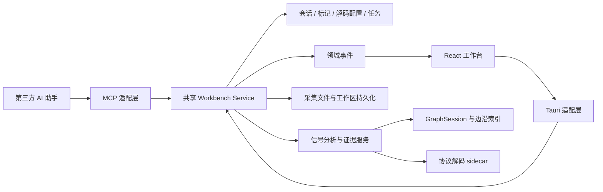

# SigPilot MCP 功能评估与规划

日期：2026-11-12，更新：2026-11-13。状态：离线核心功能、领域/界面/线协议验证及 Linux 桌面编译检查已完成；实际接口与验证记录以 [MCP 接入说明](mcp.md) 为准。

范围：面向第三方 AI 助手的 MCP 服务、精确标记、触发逻辑评估、解码检索、异常波形分析与扩展架构。按用户后续要求，构建、格式化、测试和运行全部在 Instabox 隔离工作区进行，本机只读写源码和传输文件；使用已有采集与合成 fixture，不连接测试设备。

共享 Workbench、独立采集/标记/配置/报告/结果版本、精确 u64 边沿与测量、四类标记/撤销、GUI 定位和 .pxl 保存已实现。连接包含认证 loopback HTTP、私有实例发现、stdio 桥与独立离线服务器，支持两代 MCP 协议、Resources、Prompts 和请求取消。接入侧栏独立可见，2026-11-16 已提供固定 HTTP URL（默认 10531）、跨平台注册命令、OAuth 许可与撤销及直接 HTTP 自检；用户启用/编辑/端口选择在应用启动时恢复，stdio 桥作为兼容入口。

已实现受监督 UART/I²C/SPI 解码、类型化字段、有限序列、I²C 地址段事务、协议事件与原始窄脉冲关联、有限触发校验/回放、12 个可信离线设备配置编译。共享 GUI/MCP 解码配置可 CAS 编辑，作业冻结提交配置。多通道 setup/hold 与响应延迟通过注册提供者扩展；保存完整结果、不可变证据报告及 JSON/Markdown 分块导出均有独立契约。派生数字采集保留源波形和时间轴，允许相同配置分别重解码比较。

下文完整目录仍含未来提案，不等同于全部已实现。标准 Tasks 暂不协商，保留领域作业轮询/取消；更多提供者和协议、增量分析、不可信插件隔离、派生会话自动加入 GUI及发布/平台验证后续扩展。真实设备控制与硬件触发实测不在当前实施范围。当前完整桌面及目标助手验收边界见接入说明。

## 1. 建议结论

MCP 应提供可以复核的信号分析能力：AI 理解目标并编排调用，SigPilot 执行确定性的查询、测量、校验和标记。AI 不需要通过鼠标位置推算采样点，也不需要把整份波形或整张解码表装进上下文。

先完成 **离线采集 → 查询/扫描 → 证据 → 精确标记 → GUI 定位** 的闭环，再加入触发条件校验、回放仿真和协议相关性分析。共享会话状态、精确采样坐标、稳定证据引用和有界查询是先决条件。

软件条件匹配与硬件触发要共享条件表达，但分别报告执行能力。异常脉冲检测返回观察事实与嫌疑证据；是否存在硬件故障仍需结合电气测量、采样设置和复现情况判断。

## 2. 五类需求的评估

| 需求 | 建议能力 | 输出与验收重点 | 优先级 |
| --- | --- | --- | --- |
| 手动时间标记不精确 | 按采样点、边沿、帧边界和查询命中创建标记，支持批量操作 | 返回实际采样点、锚点来源、量化方式；GUI 与保存后数据一致 | P0 |
| 多条件触发难配置、会冲突 | 结构化条件、静态校验、设备能力编译、离线回放和失败阶段解释 | 分别说明逻辑有效性、设备支持程度与历史采集中是否命中 | P1 |
| 解码表搜索后还需回波形匹配 | 类型化字段查询、有限序列查询、帧/事务到波形的证据引用 | 同时拿到帧字段、采样范围、涉及通道和定位入口 | P0 基础查询；P1 序列/事务 |
| 异常脉冲被繁杂波形掩盖 | 原始边沿窄脉冲扫描、宽度统计、解码错误附近关联分析 | 不依赖像素级波形；明确覆盖范围、规则、截断情况和证据 | P0 单规则；P1 关联分析 |
| 后续其他分析与标记工具 | 分析提供者注册、统一结果模型、能力发现、标记引用分析结果 | 新算法可复用采样、任务、结果和展示设施 | 从 P0 保留接口 |

## 3. 现有实现与缺口

以下结论来自当前工作区源码核对。

| 现有基础 | 代码入口 | MCP 接入前的缺口 |
| --- | --- | --- |
| Rust 按会话维护采集、图索引和缓存 | [AppState](../src-tauri/src/main.rs)、[GraphSession](../crates/sigpilot-graph/src/lib.rs) | GUI 的解码器配置、标记、测量区间与备注主要在 `UiSession`；不能只把现有 Tauri 命令转成 MCP 就获得一致状态 |
| 基于有序边沿的最近跳变与点测量 | `GraphSession::nearest_transition`、`measure_point` | 新增按窗口、方向、序号分页的精确边沿查询和只读扫描接口；现有图内部边沿容器不能直接对外暴露 |
| 区间测量及占空比、周期统计 | [measure_digital_range](../crates/sigpilot-waveform/src/lib.rs) | 桌面命令当前取 `CaptureData`；对仅有 `SparseCaptureData` 的会话需要补充稀疏实现，避免强制展开巨大原始数组 |
| 解码帧、表格分页与文本搜索 | `GraphSession::decode_frame_table_window`、`decode_frame_table_search_window` | 显示文本搜索受标签/进制影响；需要字段、类型、范围、序列与可索引过滤 |
| 解码后端已有类型化字段 | [DecoderFieldValue / DecoderOutputFrame](../crates/sigpilot-core/src/decoder_backend.rs) | `DecoderOutput::into_decoded_frames` 的显示帧不保留 `fields`；部分调用使用 `include_fields: false`。MCP 查询需要保留或按需获取字段，且应控制内存 |
| 通道波形标注以 `u64` 采样点保存到 `.pxl` | [WaveformAnnotation](../crates/sigpilot-file/src/lib.rs)、[用户波形标注说明](user-waveform-annotations.md) | 目前为通道上的点标注；缺少区间、来源、标签、证据引用和批量事务 |
| 单点/双点时间标记与区间测量 UI | [timingMarkers](../src/lib/timingMarkers.ts)、[UiSession](../src/App.tsx) | 模型含选择、弹窗等 UI 状态，应抽取语义数据；目前 `.pxl` 会话元数据没有统一时间标记与分析结果存储 |
| 硬件触发包含边沿/电平和额外高低掩码 | [CaptureSettings](../crates/sigpilot-core/src/models.rs)、[capture_profile_from_settings](../crates/sigpilot-core/src/capture.rs) | 当前校验包含禁用通道等；已读路径未检查高低掩码交集。没有通用逻辑 AST，也没有逐设备触发能力模型 |
| 不同设备独立注册与能力查询 | [DeviceRegistry](../crates/sigpilot-core/src/device.rs) | `HardwareCaptureCapabilities` 没有完整触发能力描述。Kingst 当前 `configure_trigger` 使用无触发配置，不能把 PXLogic 的能力推及所有驱动 |
| 协议触发已有 UI 外形 | `AnalyzerTriggerView` in [App.tsx](../src/App.tsx) | 开关、查询与 holdoff 控件处于 disabled 状态，不能视为已有可用协议触发引擎 |
| 协议、HLA、稀疏采集测试基础 | [decoder fixtures](../crates/sigpilot-core/tests/decoder_fixtures.rs)、[testdata](../testdata)、[前端测试](../tests) | 可用于离线基线；仍需专门构建异常脉冲和触发逻辑 fixture |

实现成本主要在共享状态与分析语义，MCP 协议层本身只是入口。

## 4. 服务架构与客户端连接



### 4.1 推荐模块边界

- `sigpilot-workbench`（已新增）：会话注册、标记/备注、共享解码配置、版本控制、作业管理和领域事件。依赖现有 core、graph、waveform、file 与分析服务；GUI 临时展示与解码缓存仍由前端保留。
- `sigpilot-analysis`（已新增）：基于只读采集视图的查询、条件回放、异常扫描和分析提供者；不依赖 React、Tauri 或 MCP。
- `sigpilot-mcp`（已新增）：MCP transport、协议版本适配、schema、权限检查和领域 DTO 转换；不实现算法或直接操作 USB。
- Tauri 命令与 MCP 调用同一 Workbench Service。只迁移必要的语义状态；弹窗位置、hover、临时拖动等继续留在前端。

分析模块接收采样/边沿视图及解码记录，不反向依赖 Workbench Service，以免形成依赖环。可以先以模块实现，再按边界抽 crate，无需为了接入第一批工具先重构所有 UI。

### 4.2 连接方案

推荐桌面进程内持有服务，在 loopback 提供 **Streamable HTTP** 接口，并附带一个 **stdio 桥接可执行文件**，满足只支持进程型 MCP 配置的客户端。两种入口访问同一个桌面会话服务。

stdio 桥负责标准协议适配与经过认证的上游连接，不持有第二份采集、标记或设备状态。应使用 SDK 处理两侧协议语义，验证版本、资源读取、分页和取消的转发，不直接把 stdio 字节盲目转发成 HTTP 请求。

服务在用户启用 MCP 后启动；默认固定端口 10531，允许显式修改，占用时报错。HTTP 客户端使用本机 OAuth 认证；Unix 兼容桥仍通过私有运行时文件读取实例 ID 和内部凭据。指定桌面实例连接，实例退出后返回明确错误，避免自动附着到另一个工作区。工具发现不触发设备准备或采集。

后续无 GUI 的离线服务器复用同一 Workbench Service，具备独立的业务会话；`focus_view` 等依赖 GUI 的能力则不发布或返回 `GUI_UNAVAILABLE`。

### 4.3 MCP 版本与功能边界

截至本次核对，官方当前规范为 **2026-07-28**。该版采用逐请求版本/能力声明与 `server/discover`；2025-11-25 及更早版本采用 `initialize` 握手。建议通过 SDK 支持两代协议，不把业务会话生命周期绑定到 MCP 连接或旧版 transport session。[官方版本与兼容规范](https://modelcontextprotocol.io/specification/2026-07-28/basic/versioning)

Rust 技术栈优先评估官方 `rmcp`；其当前仓库说明支持上述双代协议。实施时锁定经过客户端兼容测试的已发布版本，不直接依赖浮动 main。[官方 Rust SDK](https://github.com/modelcontextprotocol/rust-sdk)

Tools 承载操作，Resources 承载可寻址的结果/上下文，Prompts 提供分析流程模板。工具返回约定为 JSON 对象的 `structuredContent`，同时提供简短文本及结果资源链接；虽新版允许任意 JSON 值，固定对象形状便于旧客户端兼容。[官方 Tools 规范](https://modelcontextprotocol.io/specification/2026-07-28/server/tools)

当前 Tasks 属于可选扩展。首版提供普通工具形式的领域作业 ID、查询与取消，核心分析不依赖客户端实现 Tasks；以后通过适配层按协商结果映射。新版扩展与旧版实验 Tasks 的语义分别处理，不共用未经适配的报文。[官方 Tasks 扩展](https://modelcontextprotocol.io/extensions/tasks/overview)

## 5. 必须先固定的数据契约

### 5.1 精确时间与范围

- 采样坐标以 Rust `u64` 为真值；MCP 中的采样点、帧 ID、整数计数、采样率及版本号统一使用十进制字符串，避免 JavaScript 超过 `2^53-1` 后失真。
- 所有范围统一为半开区间 `[start_sample, end_sample)`；点坐标必须小于 `sample_count`，区间终点可等于 `sample_count`。
- 各解码后端的端点含义须逐一核实并在适配层归一化；单点事件单独建模。不能假定已有所有 decoder 的 `end_sample` 含义完全相同。
- 支持采集起点、触发点和稳定事件引用三种时间锚点。无触发元数据时不能猜测触发零点。
- 时间输入为十进制值加单位，或有理数；用 checked 整数/有理数换算采样点，指定 `floor/ceil/nearest/reject_nonintegral`，返回实际坐标和量化偏差。
- 触发前时间可为负，但换算得到的采样坐标仍须在范围内；绝对采集墙钟时间仅为元数据，不替代采样时间轴。
- 可精确定位到已记录的采样格点；不会因此获得设备未采到的亚采样脉冲或真实电气边沿的无限精度。

目前前端大量使用 `number`，MCP 字符串不能单独消除 GUI 精度问题。首版 UI 适配层须使用 checked 转换；未实现精确显示/相对坐标渲染的超大坐标操作返回 `UI_PRECISION_LIMIT`，不悄悄四舍五入。只读后端查询继续保留完整 `u64`。

### 5.2 版本、引用与快照

```json
{
  "schema_version": "1",
  "session_id": "session-a",
  "capture_id": "capture-a",
  "data_revision": "7",
  "range": {"start_sample": "1048576", "end_sample": "1048600"},
  "channels": [2],
  "evidence_refs": ["evidence-a"]
}
```

- `session_id` 为业务工作区会话；`capture_id` 在替换采集后改变。另有 `annotation_revision`、`config_revision` 和 `decode_revision`，避免一次加标记使所有解码失效。
- 现有 `GraphSession::revision` 可作为数据修订基础，但不能替代所有领域版本。
- 首版重分析针对已停止采集的固定快照；活动采集返回 `CAPTURE_NOT_FINALIZED`。以后再引入增量快照水位和流式状态。
- 帧引用由采集版本、解码器实例、配置哈希、解码版本和后端 frame ID 共同确定；表格行号和当前视口不是身份。
- `evidence_ref` 为服务生成的不可伪造或经校验引用，绑定采集、范围、算法版本、参数与来源。引用失效返回原因，不重新解释成当前数据。
- 不在长期扫描期间持有全局会话写锁。停止采集后的索引可通过共享所有权或有界只读视图扫描，避免每个工具复制全量边沿。

### 5.3 统一标记与分析结果

语义对象建议分为：`timing_point`、`timing_pair`、`channel_annotation`、`range_annotation`。它们共享 ID、样本坐标、标题、备注、标签、作者来源和证据引用，但保留现有 UI 展示含义。

来源用 `user / assistant / analysis_provider`，与解码器的协议标识分开；AI 创建的注释不能伪装成 decoder 错误。采集触发标记由采集元数据派生，普通标记编辑不得删除或改写它。

分析结果包括：规则/提供者 ID、版本、参数、观测值、阈值、通道、范围、严重度、证据、覆盖范围和局限。规则命中与根因猜测分开。只在算法具有可说明的评分定义时提供分数，不默认生成“硬件故障概率”。

## 6. 首版工具目录（P0：14 个）

统一使用 `sigpilot_` 前缀及英文 snake_case。工具描述说明输入单位、上限、状态影响和结果引用。

| 工具提案 | 核心输入 | 输出与作用 |
| --- | --- | --- |
| `sigpilot_get_context` | 可选 session ID | 会话摘要、活动/完成状态、采样参数、版本、解码实例、标记摘要、GUI 状态；列表和详情均有界 |
| `sigpilot_open_capture` | 本地采集文件引用 | 打开已有文件，创建独立业务会话；不覆写源文件，不隐式替换当前会话 |
| `sigpilot_list_capabilities` | 类别、可选 ID、cursor | 查询分析提供者、decoder、字段 schema 与执行状态；设备能力可使用离线描述。只返回已注册能力 |
| `sigpilot_query_edges` | 快照、通道、范围、方向、cursor | 精确边沿或最近边沿、方向、前后电平和引用；支持 first/last/nth，强制扫描/返回上限 |
| `sigpilot_measure` | 快照、point/range、通道 | 脉宽、周期、占空比、边沿数等；密集/稀疏结果遵循同一语义；多通道关系测量随后增加 |
| `sigpilot_run_decode` | 快照、已有实例或完整临时配置 | 提交解码作业，返回 job/解码结果集 ID；临时配置不修改 GUI 已保存实例 |
| `sigpilot_query_frames` | 解码结果集、类型化过滤、cursor | 精确字段或文本查询，返回帧引用、字段和样本范围；未知字段明确拒绝 |
| `sigpilot_get_evidence` | 有界 refs、上下文范围 | 展开命中附近的边沿、帧字段、测量与来源，供 AI 复核；大结果返回资源引用 |
| `sigpilot_list_annotations` | 会话、范围、标签、cursor | 列出语义标记、作者来源与证据，不返回 GUI 临时弹窗状态 |
| `sigpilot_apply_annotations` | 显式会话/采集版本、标记版本、操作批次、request ID | 原子创建/更新/删除，支持 preview 和撤销批次；P0 先覆盖点标记/通道注释，后续扩展区间 |
| `sigpilot_focus_view` | 会话、精确范围或证据引用、相关通道 | GUI 定位并返回实际采用的视口；会话未展示时明确处理，不把当前活动页当成默认写入对象 |
| `sigpilot_run_analysis` | 快照、provider ID、经过 schema 校验的参数、预算 | 首版运行窄脉冲/脉宽阈值扫描；返回作业或结果资源，不接收任意脚本 |
| `sigpilot_get_job` | job ID、可选结果 cursor | 状态、进度、快照、覆盖水位、终态结果及分页入口 |
| `sigpilot_cancel_job` | job ID | 请求取消指定作业；终态查询保持幂等，不取消其他客户端的解码 |

`preview` 为工具本身的无写入模式，不额外引入必须由用户逐个确认的流程。提交写入仍需当前连接具有标记权限；AI 可以在获授权的任务中自行完成查询、预览和提交。

P1 增加 `sigpilot_validate_trigger`、`sigpilot_simulate_trigger`、`sigpilot_configure_analyzer`；按需要增加持久化分析规则与报告导出。未来实际采集使用独立的 `sigpilot_apply_capture_plan`、`sigpilot_start_capture`、`sigpilot_stop_capture`，不让校验工具隐式启动设备。

### 6.1 Resources 与 Prompts

资源 URI 提案：

- `sigpilot://sessions/{session_id}/captures/{capture_id}/summary`
- `sigpilot://schemas/analysis/{provider_id}/{schema_version}`
- `sigpilot://results/{result_set_id}/pages/{page_id}`
- `sigpilot://evidence/{evidence_id}`
- `sigpilot://reports/{report_id}`

每次资源读取执行权限与版本校验。自定义 URI 是 MCP 资源地址，不保证普通浏览器可打开；GUI 定位通过 `focus_view` 完成。资源读取同样限量，不能用“一个资源链接”隐藏随后读取数百万行的数据量。

首版核心操作只依赖 Tools；Resources 辅助传递结果，Prompts 可在 P1 提供“定位指定协议事件”“诊断触发未命中”“扫描并标注窄脉冲”三类模板。模板只指导工作流，不替代算法或授权。[官方 Resources 规范](https://modelcontextprotocol.io/specification/2026-07-28/server/resources)

## 7. 典型闭环

### 7.1 精确标记

用户目标：“标出 D2 上第一个小于 200 ns 的高脉冲起点。”

1. 获取采集元数据与固定快照，明确 D2 已采集、采样率和扫描范围。
2. 用 pulse-width 提供者扫描，返回完整脉冲区间和宽度；未闭合的边界脉冲标为不完整。
3. 获取首个命中证据，以它的 `start_sample` 作为标记锚点，不通过屏幕像素反算。
4. 用显式会话/版本原子创建标记，引用命中结果；重复请求不重复创建。
5. 定位到该范围，保留前后若干边沿作为上下文。

### 7.2 协议到波形

用户目标：“找到 I²C 中的 NACK，并查看附近 SDA 的短脉冲。”

1. 使用已配置或临时 I²C 解码参数运行解码。
2. 根据结果集声明的 schema 查询 NACK 字段/事件，不从显示标签猜字段值。
3. 取命中事件的采样窗口，在 SDA 原始边沿中扫描脉宽。
4. 返回关联帧、脉冲和时间差；可批量标注并定位。

如果某后端没有 ACK/NACK 类型化字段，须明确降级到其事件/文本查询并说明语义限制。解码字段缺失不能当作 ACK，更不能把通用 `value` 的默认零当作真实数值。

“地址为 0x50 的事务中出现 NACK”需要事务上下文；地址帧与数据/ACK 帧可能分开，不能简单要求同一行同时具备 address 和 nack。该能力属于 P1 事务聚合/序列查询。

### 7.3 触发诊断

用户目标：“D0 上升沿之后 10 μs 内 D1 出现窄脉冲，同时 D2 处于低电平。”

AI 先形成结构化条件，服务校验约束与时序语义，再在指定采集中回放，显示每一步命中数和被后续条件排除的证据。设备无法实现完整条件时报告软件可回放、硬件不可编译或部分可编译，不静默放宽原条件。

## 8. 触发条件模型（P1）

### 8.1 条件表达

采用带 schema 的声明式 AST，而不是把自然语言直接拼成寄存器值。

原语：`edge`、`level`、`pulse_width`、`frame_match`。组合：`all`、`any`、有限 `sequence`；每个序列阶段绑定一个明确的事件锚点，可附电平守卫、相对时间窗口、holdoff 与重叠匹配策略。

示例：

```json
{
  "schema_version": "1",
  "execution_target": "offline",
  "condition": {
    "op": "sequence",
    "steps": [
      {"event": {"type": "edge", "channel": 0, "direction": "rising"}},
      {
        "event": {
          "type": "pulse_width",
          "channel": 1,
          "level": "high",
          "width": {"lt": {"value": "200", "unit": "ns"}}
        },
        "anchor": "pulse_end",
        "guards": [{"type": "level", "channel": 2, "value": "low", "phase": "after"}],
        "within": {"value": "10", "unit": "us"}
      }
    ]
  }
}
```

这里第二步要在脉冲结束后才能判定宽度，窗口约束作用于 `pulse_end`；若用户要求脉冲起点在 10 μs 内，必须换成 `pulse_start` 的匹配时间语义，并返回实际确认时间。标记时间与条件确认时间分别保存。

首版支持一个明确有限子集：电平守卫、单边沿、多通道电平 conjunction、有界宽度条件和有限序列。自由 NOT、无限等待、任意递归或脚本在未定义完语义前不发布；以后扩展 AST 时保持版本化。

### 8.2 校验与结果分层

| 层次 | 需要判断的内容 | 结果示例 |
| --- | --- | --- |
| 参数/结构 | 通道、单位、范围、序列窗口、最大复杂度、锚点和 phase 是否明确 | `invalid_model`，带 JSON path 与原因 |
| 静态可满足性 | 同一步同一 phase 的高低冲突、宽度上下界交集为空、已知互斥条件 | `proven_unsatisfiable / satisfiable_in_model / inconclusive` |
| 设备编译 | 此驱动与模式支持哪些原语、阶段数、通道条件和量化精度 | `supported / partially_supported / unsupported / unverified` |
| 历史回放 | 固定采集中各步骤和整体是否命中 | `matched / no_observed_match / incomplete` |

只有在明确支持的逻辑子集中给出可满足性证明；对超出求解范围的规则返回 inconclusive。`no_observed_match` 仅说明这份数据没有命中，不能推导规则永远不可能触发。

边沿与电平必须明确取跳变前还是跳变后。比如“上升沿 + 同通道低电平”在 before phase 可以成立，不应仅因两个条件看起来相反就报冲突。默认值和归一化条件要随响应返回。

设备描述除了型号，还包含采集模式、使能通道、采样率限制、触发阶段/组合能力、量化规则、外部触发和验证状态。离线描述可判断已声明的软件支持；不能取代真实设备配置和实际触发测试。

回放输出各阶段计数、guard 被拒原因、序列超时次数、候选/成功证据、扫描边界和时间预算。多步骤规则先做到可解释，再考虑更大求解器；没有必要首版引入完整 SAT/SMT 引擎。

## 9. 协议检索与索引

### 9.1 类型化记录

公共最小模型：protocol、analyzer ID、backend、frame ref、事件类型、通道、采样范围、typed fields、明确错误事件与原始显示文本。

保留 native 字段及其原始命名空间，通过协议适配器提供规范字段。字段可能为整数、布尔、字节序列、文本或缺失；缺失/不可获得为 unknown，不自动补零/false。声明字段的适用事件类型，避免在没有 address 的 data 行上进行错误匹配。

`query_frames` 支持字段比较、事件类型、通道、时间范围与有界文本查询。首版使用结构化 filter，不开放任意 SQL、正则表达式或代码求值。字段类型不符、未声明字段和不支持的 operator 返回明确错误。

### 9.2 内存与查询成本

- 时间索引、事件类型与常用规范字段优先；按结果集建立索引，键包含采集版本、解码配置和后端版本。
- 显示帧保持紧凑。MCP 请求选定字段时再从结构化结果存储/后端详情取得；按需字段必须按同一解码快照获取，不能悄悄重解码后套用旧 frame ID。
- 返回 projection、limit、cursor 和扫描预算；cursor 绑定结果集、过滤条件、排序与版本，采用稳定排序。
- 查询某时间窗可能需要从前面开始解码以恢复协议状态。区分用户要返回的范围和实际处理范围，不能把窗口解码伪装成必然局部计算。
- P1 引入序列与事务聚合、多通道时序关联、超时缺失响应；协议约束放在适配器内，保留公共框架。

## 10. 异常脉冲与质量分析

P0 提供确定性的高/低脉宽阈值扫描：从原始有序边沿计算相邻完整脉冲，应用用户给定的阈值，返回最短、最长、命中次数和位置。首尾不完整脉冲不能当完整脉冲的精确宽度。

| 后续提供者 | 判定依据 | 局限 |
| --- | --- | --- |
| 相对异常脉宽 | 按局部协议阶段/电平分组的分布、MAD 或分位数，加绝对阈值 | 避免把合法短数据脉冲与长 idle 间隔放进同一分布；仍有误报 |
| 时钟质量 | 周期/占空比偏差、缺失或额外边沿、频率漂移 | 需指定时钟与期望参数；有限采样分辨率影响判断 |
| 协议错误相关 | 窄脉冲与 framing、parity、ACK、CRC 等已知错误事件在时间上的关联 | 同时发生不代表因果；错误字段可能不可用 |
| 多通道关系 | setup/hold、片选边界、响应延迟、特定边沿顺序 | 首版对采样格点做数字时序检查，不直接承诺电气规格符合性 |
| 采集质量 | 缺口、截断、不可用通道、接近采样分辨率的事件 | 采集层须有真实元数据才能检查，不能凭波形臆测 USB 丢包 |

零命中时要返回扫描覆盖、有效阈值、是否扫描完整和边界未知情况。采样前端或硬件 glitch filter 已过滤的脉冲不能从现有采集中恢复；采集设置缺失时明确标记 unknown。因此后续采集应保存请求/实际采样设置、过滤配置、设备与导入来源。

P1 可提供对同一采集的“保留源数据 + 派生过滤视图 + 再解码对比”。只改变派生数字电平，不删除采样点或压缩时间轴。派生结果具有自己的 ID、参数、版本和映射；不能覆盖原始证据。解码改善只支持相关性判断，不证明真实线路就应去掉这些脉冲。

## 11. 扩展机制

分析提供者注册信息：`provider_id`（如 `sigpilot.pulse_width`）、版本、输入/输出 schema、依赖能力、适用数据类型、预算、取消能力、确定性、参数说明和是否可增量执行。

稳定高频操作保留独立 MCP 工具；新增低频算法可通过 `list_capabilities → run_analysis` 发现并调用。`run_analysis` 只调用已注册且通过 schema 校验的 provider，不能成为任意函数/脚本入口。提供者越多时，可按能力配置发布工具集合，避免启动时向 AI 注入巨大 schema。

区分两类扩展：decoder 负责把波形转为协议事件，analysis provider 负责查询、断言、统计与关联；HLA 是已有协议分析生态的一部分，不应承担所有通用波形算法。

首版使用内置 Rust 提供者与已有 decoder 进程隔离。以后再为可信本地插件定义 IPC、超时、资源上限与版本协议；外部助手不得通过 MCP 安装或执行任意 HLA/Python 文件。

结果引用统一接入标记、证据查看、报告与 GUI；添加算法不需要复制一套任务或侧栏基础设施。预留 `supports_incremental`，但首版不承诺在线流式执行。

## 12. 一致性、作业与性能

### 12.1 写入一致性

所有写入显式指定业务会话与采集版本；标记修改还携带预期标记版本。采用 compare-and-swap 与原子批次，冲突返回 `VERSION_CONFLICT` 和最新版本，禁止按“当前活动页”重定向。

`request_id` 在客户端身份与业务会话内去重，并校验请求内容哈希；同 ID 不同请求拒绝。重复提交返回原批次结果，包括生成的标记 ID。标记写入触发 GUI 领域事件，并进入统一撤销记录；撤销自身也须检查版本。

首版保留短期去重记录与撤销记录，声明保留期。不能承诺应用崩溃后仍有“恰好一次”写入；若要跨重启可靠性，写入日志与去重状态须在响应前持久化。

### 12.2 作业管理

内部状态：queued → running → completed / failed / cancelled；cancel_requested 不等于已取消。每个作业有 owner、采集快照、参数哈希、进度、错误、结果引用和保留期。

初版断开客户端连接不取消作业；应用进程退出则作业终止，重连明确返回失效状态，不声称自动续跑。持久化恢复与标准 Tasks 扩展映射为后续能力。共享 decode 计算若有多个消费者，应释放当前订阅者引用，而非用现有全局取消入口杀死所有任务。

首版重作业设有限队列，每会话默认最多一个重分析任务，全局并发按性能预算设置。读写锁及 decoder 队列策略要防止扫描挤占波形渲染。按需提供进度通知，但轮询始终可用；通知丢失不会让结果不可获取。

### 12.3 初始预算提案

- 查询默认 100 条，单页最多 1,000 条，响应总大小同时限制在约 256 KiB；字段/备注过大时进一步减少条数。
- 普通短查询采用约 2 秒的计算预算；需要全量解码/扫描时提交 job，不在 HTTP 请求内无限等待。
- 标记批次先限制 200 项，先验证全部再提交；大批量操作分批，并明确各批次原子范围。
- analysis 请求同时限制范围、候选数量、内存、时间和并发。允许调整上限，但由服务策略决定。
- 每次返回 `coverage`、`complete`、`truncated`、`next_cursor` 和停止原因。命中数量上限与扫描上限分别报告，避免将“已扫描完但仅返回第一页”误读成扫描未完成。

这些是初始工程预算，需离线基准后调整，不是已测量的性能承诺。

## 13. 本地访问与持久化

连接权限建议至少区分读取、运行分析、编辑标记、写文件、控制采集。P0 可启用读取/分析/标记，不发布真实采集工具；修改内存标记与覆写采集文件分开授权。

loopback HTTP 接口仍需认证并校验 Origin，使用随机凭据且不写入普通日志；公网/局域网服务属于独立扩展，不作为首版默认行为。[官方 Streamable HTTP 要求](https://modelcontextprotocol.io/specification/2026-07-28/basic/transports/streamable-http)

文件打开只接受授权文件/目录引用，不提供任意路径浏览工具。协议载荷、注释及外部插件文本作为待分析数据，不作为服务指令。MCP 工具的 readOnly/idempotent 等 annotation 只是提示，实际权限与版本检查由服务执行。

`.pxl` 后续扩展建议分开保存语义标记、分析结果元信息与 provider 扩展区，并使用独立 schema version。旧版通道注释兼容映射到 `user_annotations`；新版本保存时保留未识别扩展区，旧文件缺字段按默认处理。

缓存/大量可重算的帧索引不必都写入工作区。持久化证据若只存运行期 ID，重开后会失效；必须同步保存其采集身份、样本位置、算法/配置和必要的证据内容。导出到无法表示新语义的格式时需提示丢失哪些内容，不能承诺老版本编辑器能保留未知字段。

## 14. 无硬件实施顺序与验收

| 阶段 | 交付 | 前置依赖 | 粗略工作量 |
| --- | --- | --- | --- |
| A：共享基础 | Workbench 语义状态、精确 DTO、采集版本、领域事件、任务/结果骨架、认证入口 | 核对 UI 状态与 `.pxl` 迁移 | 1–2 工程周 |
| B：P0 离线闭环 | 14 个工具的必要子集逐步上线，字段查询、边沿/稀疏测量、窄脉冲扫描、标记/定位、stdio 接入 | A；结构化解码字段路径 | 2–3 工程周 |
| C：P1 可解释规则 | 触发 AST 校验/回放、设备能力描述、事务/序列与错误相关分析、结果持久化 | P0 稳定契约与 fixture | 2–3 工程周 |
| D：扩展分析 | 多通道时序、派生视图对比、报告、更多提供者、标准 Tasks 适配 | 按实际场景挑选 | 单独估算 |
| E：后续采集自动化 | 采集计划应用、设备执行、实际触发验证、增量分析 | 单独安排设备与平台验证 | 本次不估算、不联调 |

工作量以一名熟悉仓库的开发者为假设，包含必要回归和兼容验证；A+B 的首个可用离线版本约 3–5 工程周，是初步判断而非交付承诺。若保留全部解码字段造成明显内存增长，或前端语义状态迁移超出预期，应优先缩小协议/工具子集，不放松采样精度与一致性要求。

### 14.1 必测离线场景

1. **精确标记**：指定采样点、nearest/nth 边沿、解码帧边界、重复请求、批次失败无部分写入；保存/重开 `.pxl` 后精确坐标与来源一致。
2. **密集/稀疏一致**：同一信号两种表示，边沿查询、脉宽和区间统计一致；无须把稀疏长采集展开为密集数据。
3. **触发逻辑**：同一 phase 高低矛盾、before/after 合法组合、禁用通道、空宽度区间、序列超时、边界不完整；零历史命中不被报告为逻辑不可能。
4. **解码检索**：字段缺失、文本/进制变化、帧到波形映射、地址/ACK 跨行上下文、解码配置变化后旧 cursor/ref 失效。
5. **脉冲异常**：注入 1/2/3 采样格宽度脉冲、合法短脉冲、边界未闭合、局部时钟变化；返回实际格点宽度并说明无法检测未被采到的事件。
6. **会话并发**：GUI 编辑与 AI 标记冲突、切换活动会话、替换采集、客户端重试/断线、取消一个作业不影响其他消费者。
7. **大数据预算**：长 idle、高边沿密度、巨大解码表；响应和内存有界，GUI 操作不会因分析长期锁定。
8. **MCP 客户端兼容**：2026-07-28 与 2025-11-25 路径、HTTP/stdio、Tools-only 客户端、资源读取、分页、错误、job 查询/取消；未协商 Tasks 时不返回 Tasks 扩展报文。

复用当前 decoder/HLA fixture；新增确定性的触发和噪声注入 fixture。先以工具协议测试和桌面本地事件回归验收，再请目标 AI 客户端使用同一份小采集完成闭环。任何通过都不等同于真实硬件触发验证。

### 14.2 建议首个开发切片

先落地 `get_context → query_edges → apply_annotations → focus_view`，连通共享会话、精确采样与 GUI 事件。随后添加稀疏测量、临时解码/字段查询与 pulse-width provider。触发 AST 在这些基础可复核之后实施。

首版冻结的关键决策：原始采样点为真值、显式业务会话、GUI/MCP 共用服务、后端保留结构化解码证据、每次查询报告覆盖范围、算法与协议 transport 解耦。具体 provider 数量、客户端列表和预算阈值可在实施中调整。
