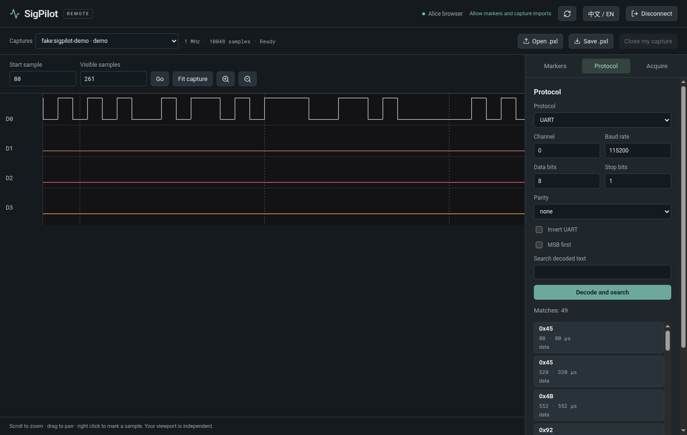

# 远程工作台

远程工作台让其他电脑的浏览器通过局域网或已有 VPN，访问现场 SigPilot 中的数字采集。设备仍连接现场主机的 USB；设备初始化、固件/bitfile 加载、采集、索引和解码由现场 Rust 后端执行。远程电脑不需要安装 SigPilot 或 USB 驱动。

截图来自 Instabox 上运行的生产前端。点击 UART 解码结果后，浏览器定位到对应的波形区间。

## 开启与连接

1. 在现场电脑打开 SigPilot，点击侧栏的 **远程工作台**（快捷键 `N W`）。
2. 勾选 **允许局域网 / VPN 连接**。确认浏览器访问地址是现场电脑的局域网 IP，或填写 VPN IP，例如 `http://192.168.1.20:10532`。默认端口为 `10532`。
3. 选择是否允许编辑标记、导入采集，以及是否允许远程发起采集。点击 **开启服务**。
4. 将访问地址和访问码分享给使用者。在远程浏览器打开地址，填写浏览器名称和访问码即可连接。
5. 保持现场 SigPilot 运行。防火墙需要允许选定的 TCP 端口；VPN 客户端需要有到现场主机的路由。

若从源代码使用 Tauri 开发模式，请先运行 `pnpm build`，使桌面程序可以提供浏览器资源。

仅用于本机测试时，可以保留 `http://127.0.0.1:10532`，不勾选局域网监听。访问地址是严格校验的根 URL；使用其他主机名或地址访问会被拒绝。直接监听目前为 IPv4。服务固定使用所选端口，占用时会报错，不会自动切换到其他端口。

配置保存在应用数据目录中。服务每次打开程序后手动开启；访问码不落盘。**应用配置会重启服务、更换访问码，并使已授权浏览器重新登录。** 已启动的采集不因浏览器退出、断网或远程服务关闭而停止，现场桌面仍可停止采集。

## 首版能力

- 读取现场已打开的数字采集，以及远程导入/发起的采集。
- 使用现有波形绘图组件；滚轮缩放、拖动平移，或输入精确起始样点与可见样点数。每个浏览器保留自己的视口。
- 在输入样点或波形右键位置创建时间点、时间对、通道标记和范围标记。标记与现场桌面及其他浏览器共享；编辑冲突会要求刷新，撤销只针对本浏览器的上次修改。
- 测量指定通道、指定样点附近的脉宽和周期。
- 设置 UART / I²C / SPI 参数，搜索解码结果，分页查看并点击结果定位波形。查询在现场解码，不传输整段原始采集。
- 将采集及共享标记保存为 `.pxl` 下载，或导入 `.pxl` 文件重新分析。可关闭本次浏览器连接创建的已完成采集，释放内存；现场已打开的采集不允许从浏览器关闭。
- 经现场授权后，枚举设备、读取能力、发起数字采集和停止本浏览器的采集。设备参数需符合实际硬件能力；首版暂不支持等待触发。
- 事件断线后自动重连并重新读取快照；慢客户端不会在采集线程中等待网络发送。

远程浏览器目前是独立工作台入口，尚未包含完整桌面上的模拟波形、所有解码器、报告、扩展和终端功能。MCP 仍使用独立的本机 `10531` 端口与 OAuth 授权。

## 访问授权与请求预算

访问码只用于交换会话 Cookie。Cookie 为 HttpOnly、SameSite=Strict，有效期 8 小时。现场可撤销某个浏览器；关闭或重启服务使所有会话失效。服务不提供跨站 CORS，校验 Host、Origin 和写入请求标记。公网地址必须配置 HTTPS；内置监听本身不提供 TLS，HTTPS 地址需由反向代理终止 TLS，并保留与外部地址匹配的 Host/Origin。

首版针对可信局域网或加密 VPN。HTTP 不加密网络内容。公网账户、用户/项目权限及多现场管理在后续 roadmap 中，首版不提供公网中继或自动穿透。

| 项目 | 首版上限 |
| --- | --- |
| 已授权浏览器 | 16 个 |
| 波形请求 | 4096 像素、32 个通道；显式视口 |
| 后台重操作 | 同时 2 个，繁忙时返回重试提示 |
| 波形更新 | 交互请求合并；采集中界面更新约最多 5 次/秒 |
| 解码请求 | 100 行/页，界面使用 50 行/页；查询文本 512 字节 |
| 事件 | 保留最近 64 条，长轮询等待最多 20 秒；缺页时重新取快照 |
| 远程采集 | 1–60000 ms、1–64 MiB、最多 32 通道，同一时刻一次；运行 60 秒后请求停止 |
| 文件 | 导入 32 MiB；下载 128 MiB |
| 工作区 | 32 个已保留会话时拒绝继续远程导入/采集，需要关闭本次连接创建的采集，或在现场释放已打开的采集 |

波形传输复用桌面的 `PXGF1` 二进制格式。1920 像素 × 32 通道的压缩数字 bins 约为 0.98 MB/帧，不含附加信息；5 帧/秒约 39 Mbps。这是尺寸估算，不是硬件吞吐或网络性能实测。带宽受限时可缩小浏览器窗口的波形区域；更完整的网络带宽控制属于后续阶段。

## 架构与扩展

`sigpilot-remote` 定义领域 HTTP API、授权、事件和采集任务。`CaptureController` 接口由桌面适配器复用现有设备路径；未来无界面现场服务可实现相同接口。静态浏览器资源与桌面资源由一次 Vite 多入口构建打包，统一使用同一波形引擎、工作台状态和文件格式。

WebUSB 本地版使用另一种设备适配器，由浏览器直接连接本地 USB，与异地访问服务分开实施。两条路线及后续顺序见 [Web roadmap](web-roadmap.md)。

## 验证

所有构建和运行检查在 Instabox 的隔离工作区执行，受 1 CPU、2 GiB 内存、零 swap 与磁盘保留预算限制。

接口验证：`cargo test -p sigpilot-remote -- --test-threads=1`。

浏览器验证：浏览器检查使用一个 CPU 和 Canvas2D 绘制路径，以保持 Chromium 在线程预算内。先执行生产前端构建及 `cargo build -p sigpilot-remote --example remote_gui_fixture`，再通过 `tools/instabox/limited-run.py` 运行 `node tools/remote-workbench-verify/run.mjs`。检查使用实际 Rust `FakeBackend`、工作台服务和 Chromium，测试资源和访问码只放在临时私有目录。

加上 `--lan` 可通过 Instabox 的私有 IPv4 网卡重复浏览器验证。2026-11-18 的测试中，两个浏览器分别查看不同的波形位置，样点 5 的标记在两侧均显示为 5 μs。测试还验证了断线重连、UART 解码定位、文件重开、从界面发起采集与撤销授权。实际 USB 设备持续采集、Windows/macOS 安装包运行和跨主机 VPN 吞吐留待实机验收。
