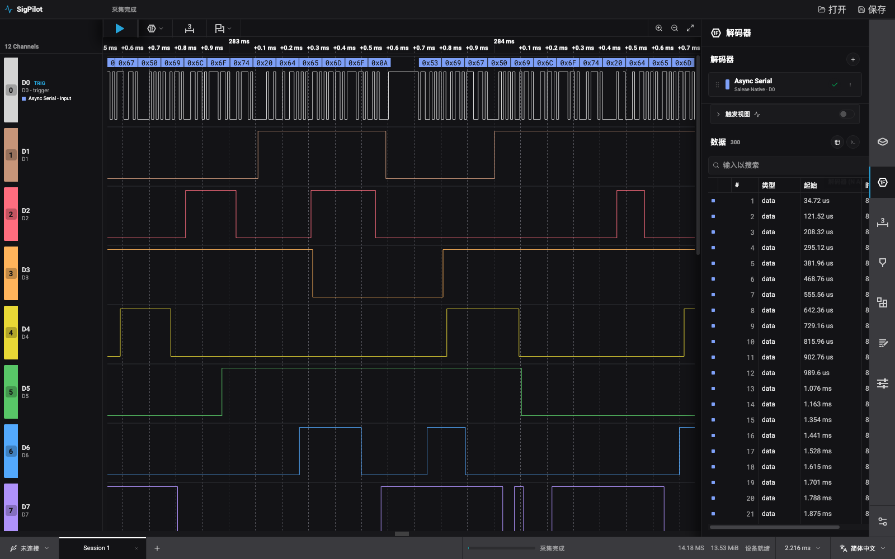
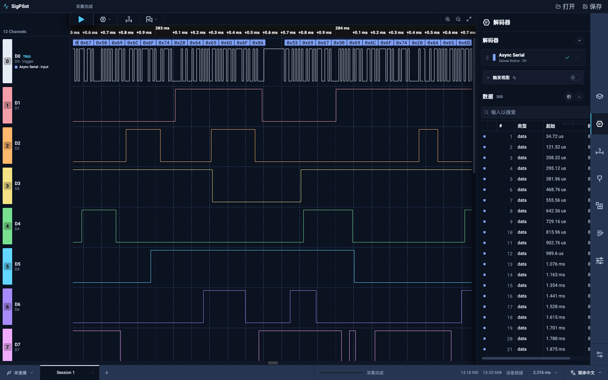
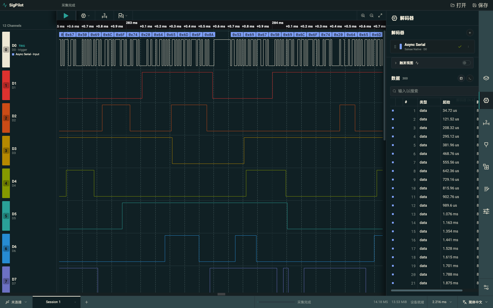
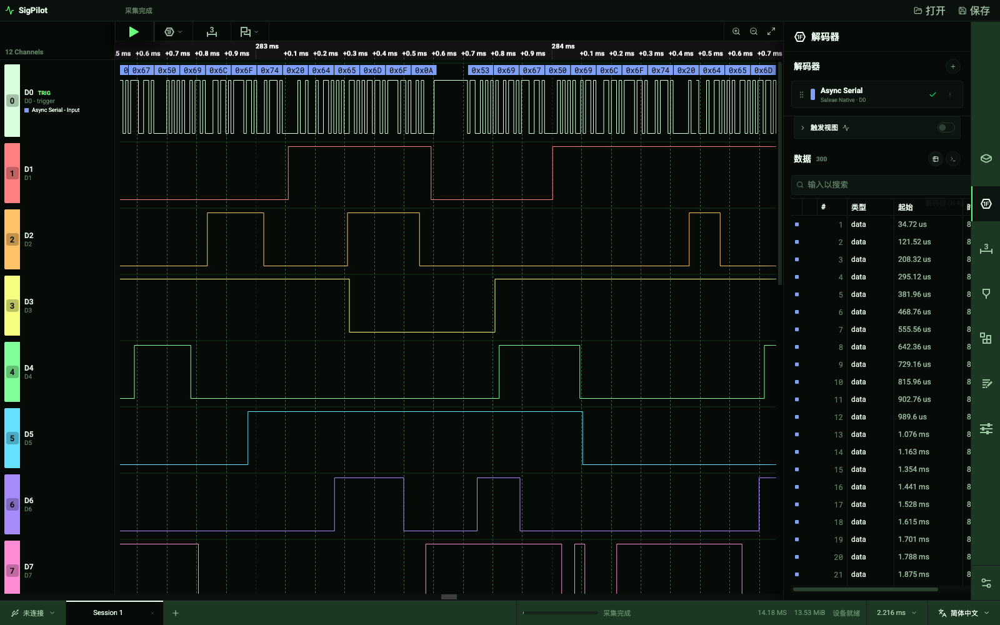
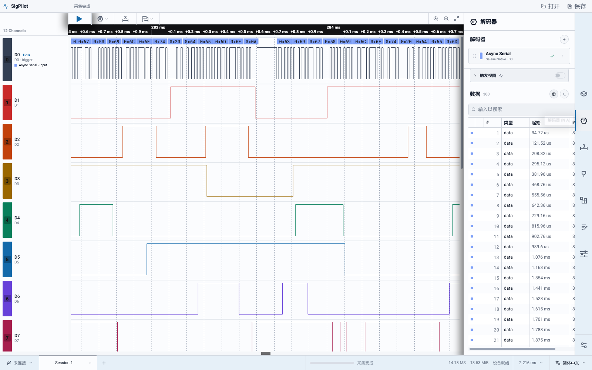

# SigPilot UI 主题扩展

SigPilot 的主题采用“主题定义 + CSS 变量 + 通道色板”的管理方式。内置主题和第三方主题使用同一接口，不需要修改组件中的厂商或颜色判断。

## 内置主题

当前提供：

- `saleae-dark`：原有默认深色主题，保留原 Saleae 兼容通道色板。
- `midnight-aurora`：深蓝背景、青色与紫色强调。
- `solarized-night`：低对比蓝绿色背景与 Solarized 信号色。
- `terminal-green`：黑底绿色仪器终端风格。
- `lab-light`：明亮实验室风格。

右侧栏底部的“偏好设置”按钮是全局入口，无需连接设备或打开采集。也保留设备设置、采集设置和高级设置面板顶部的“外观 → 配色主题”快捷入口。两个入口使用相同组件和全局偏好，选择会保存到 `sigpilot.preferences.v1`。

## 主题预览

以下五张截图来自实际运行的 SigPilot 前端，使用同一段浏览器演示采集、相同缩放与串口解码视图。它们是完整原图，没有总览图中的透明度、阴影或层叠效果；演示数据不代表硬件或原生 sidecar 实测。[返回项目介绍](../README.md#主题画廊)。

### Saleae Dark

默认深色工作台，搭配经典通道色板。



### Midnight Aurora

深蓝背景，以青色与紫色强调选中状态和信号。



### Solarized Night

蓝绿色底色与暖色信号组合，整体色调更柔和。



### Terminal Green

黑绿色仪表风格，保留多通道的独立配色。



### Lab Light

明亮的浅色工作台，适合光线充足的桌面环境。



## 创建主题

主题定义位于 `src/lib/themes.ts`，接口如下：

```ts
import { registerUiTheme } from "./src/lib/themes";

registerUiTheme({
  id: "my-bench-theme",              // 2–64 位小写字母、数字、连字符
  label: "My Bench Theme",
  description: "A personal oscilloscope palette.",
  cssVars: {
    "--background-0-base": "18, 22, 28",
    "--background-0": "rgb(var(--background-0-base))",
    "--background-10": "#12161c",
    "--background-20": "#18202a",
    "--background-30": "#202a36",
    "--background-40": "#293545",
    "--hover-background": "#314154",
    "--on-background-0": "#f5f8fc",
    "--on-background-10": "rgba(245,248,252,.94)",
    "--on-background-20": "rgba(220,230,242,.76)",
    "--on-background-30": "rgba(190,205,224,.58)",
    "--on-background-40": "#71839b",
    "--surface-10": "#18202a",
    "--surface-20": "#202a36",
    "--border-10": "#202a36",
    "--border-20": "#344356",
    "--selected-highlight": "#4cc9f0",
    "--lightBlue-base": "76, 201, 240",
    "--lightBlue": "rgb(var(--lightBlue-base))",
    "--positive": "#2bc98a",
    "--other-primary": "#dce6f2",
    "--other-primary-base": "220, 230, 242",
    "--on-other-primary": "#121820",
  },
  channelColors: [
    "#e7eef7", "#ff8fa3", "#ffc078", "#f5e663",
    "#7ee2a8", "#65d9ff", "#a78bfa", "#f0a5dc",
  ],
  gridlinePrimary: "#2c4055",
  gridlineSecondary: "#55718d",
});
```

### 注册和生命周期

- `registerUiTheme(theme)`：校验并注册/替换主题。相同 `id` 会被替换，便于开发者热更新主题。
- `listUiThemes()`：取得设置面板可选主题列表。
- `getUiTheme(id)`：按 ID 取得主题；未知 ID 安全回退到 `saleae-dark`。
- `unregisterUiTheme(id)`：删除第三方主题；内置主题不能删除。
- `applyUiTheme(theme)`：将 `cssVars` 应用到 `document.documentElement`。
- `channelColorForTheme(theme, index)`：取得循环使用的数字/模拟通道颜色。

第三方插件可以在启动阶段导入自己的主题模块并调用 `registerUiTheme`。如果主题需要跨重启保留，插件应自行保存主题定义，然后在启动时重新注册；偏好只保存当前 `themeId`，不会把任意 CSS 直接写入偏好存储。

## 设计约束

- `channelColors` 至少包含 1 个六位十六进制颜色；当通道索引超出色板长度时循环使用，内置色板为 8 色。
- `gridlinePrimary` 和 `gridlineSecondary` 必须同时提供。
- CSS 变量应覆盖背景、表面、边框、文字、强调色和状态色，避免主题只改变局部区域。
- 主题不得包含脚本、URL、字体加载或任意 DOM 操作；主题定义仅是数据。
- 自定义主题应检查明暗背景下的文字对比度，并确保选中态、错误态、禁用态仍可区分。

## 波形颜色同步

修复前，数字波形 Worker 通过模块级 `activeTheme` 读取颜色，但 Worker 与主线程有各自独立的模块状态，主线程切换主题不会改变 Worker 的主题。位图缓存及请求去重也未包含调色板，导致已有波形继续复用旧色位图。

现在瓦片和视口变换请求均携带 `channelColors`，WebGL2 与 Canvas2D 回退统一按物理通道索引取色，和左侧栏使用同一取色函数。瓦片、视口及主线程回退缓存均记录调色板，并在颜色变化时失效；主题修订触发静止画布重绘，不需要重新采集或缩放。快速切换仅保留最新排队请求，切回在途主题时清除过期队列。

“波形同色显示”开启时波形与通道栏颜色一致；关闭时使用主题的“单色波形”颜色。Canvas 与 Worker 的背景、文字、网格、分隔线、测量、游标和单色波形均接入语义色。Worker 请求和位图缓存同时包含调色板与语义色快照，颜色变化后不会复用旧色位图。

## 自定义主题编辑器

入口：右侧栏底部 **偏好设置 → 外观 → 复制为自定义主题**。内置主题只读，保存后的自定义主题支持再次编辑、复制和删除。

### 编辑与预览

- 29 个语义颜色字段按背景/表面、文字、边框/强调、状态、波形/测量分组；颜色选择器和 `#RRGGBB` 输入均可使用。内部灰阶由核心语义色派生，不暴露布局参数。
- 编辑时保留独立草稿，默认实时预览整个工作区；也可关闭实时预览，只观察样例。编辑控件保持固定、可读的安全配色，避免低对比草稿使取消按钮不可辨认。
- **应用并保存**才持久化；取消编辑、关闭弹窗、Esc 或点击背景会恢复已保存配色。主题下拉在编辑期间禁用，防止误切换丢失草稿。
- 支持主题名称、恢复基底主题的界面及循环配色；恢复不清除逐通道覆盖，清除覆盖有独立操作和确认。
- 主文字与面板对比度低于 4.5:1、通道与波形背景对比度低于 3:1 时给出提示，不强制阻止专业用途的配色。
- 保存失败显示错误并保留草稿；内置主题和已保存主题不会被预览修改。

### 通道色：8 色循环 + 独立覆盖

- 基础色板始终展示 8 槽，标注 D0/D8/D16 等影响范围。数字和模拟通道分别按物理编号循环取色。
- “逐通道独立颜色”默认折叠，展开后展示当前设备支持的全部通道（包括未启用通道）；只读采集使用采集通道数量，不使用当前连接设备的布局。
- 支持 ID/名称搜索，以及全部、仅启用、仅独立设色、数字、模拟过滤。无设备或采集时仍能编辑循环色板。
- 设置任意通道颜色会创建稀疏覆盖；“恢复继承”仅移除此通道覆盖。可清除本设备全部覆盖，或将当前筛选通道颜色展开为独立色；展开操作需确认，因为它会冻结当前颜色。
- 最终颜色为 `override[deviceProfile][kind + physicalChannelId] ?? palette[physicalChannelId % 8]`。D0 与 A0 分开保存，通道重排、重命名和禁用不改变取色键。
- 覆盖按设备型号/通道布局保存，不绑定序列号。切换主题保留显式覆盖，未覆盖通道跟随新色板；切换设备不删除其他设备配置。
- 主线程将数字覆盖解析成完整色表后传给 Worker，模拟通道单独解析，确保波形与标签一致且 D8 覆盖不会影响 D0/D16。

### 持久化与导入导出

- 自定义库保存到 `sigpilot.themes.v1`，版本为 `1`；当前主题 ID 仍保存到 `sigpilot.preferences.v1`。启动先加载/注册主题库，再读取主题选择。
- JSON 导出包含当前主题的语义色、8 色色板及设备覆盖；导入始终作为新草稿，不静默覆盖已有主题，应用后才保存。文件中的设备覆盖合并进草稿，取消可撤销导入。
- 导入限制 256 KB、一个主题、受支持版本与字段白名单，只接受六位 HEX，不接受 CSS、URL、脚本或原型字段。拒绝重复 ID、无效物理通道与异常数量。
- 删除自定义主题后选择其内置基底主题，设备覆盖保留。主题库损坏或不可读时安全回退；写入失败不会假报保存成功。

### 取舍与边界

固定 8 槽保持简便，稀疏覆盖满足部分或全部通道独立设色；不强制将循环配色复制成 N 色，因此后续色板更新仍可继承。配置分层借鉴 VS Code 的 [Workbench colors](https://code.visualstudio.com/api/references/theme-color) 思路，而非照搬其界面。

本次不修改采集文件格式，不将主题嵌入采集文件；现有用户明确设置的测量/分析器颜色及静态品牌插图保留，不被全局主题强制覆盖。可变色板长度、自动生成色盲色板、云同步与左侧通道菜单快捷设色不在本次范围。

## 验证

- `npm run build`：TypeScript 和 Vite 构建通过；仅有非阻断的大包告警。
- 回归测试覆盖语义色映射、重启恢复、JSON 往返、安全拒绝、存储异常、D/A 覆盖隔离、循环继承、变量回滚、组件预览/取消/应用/失败保留草稿。
- 隔离执行实际 Worker，验证 Canvas2D 绘制调用与 WebGL2 颜色 uniform，包括分隔线、单色波形、瓦片/视口变换及缓存失效。该测试不等同于 GPU 像素实测。
- 浏览器视觉/点击验证仍受环境限制：Tabbit launcher 返回 exit 69，未列出可用实例；需在可连接浏览器或桌面环境补做。
- 最终全量命令 `node --experimental-strip-types --test tests/*.test.ts`：198 项通过，0 失败。
- `git diff --check` 通过；中英文设置文案键一致性检查通过。
