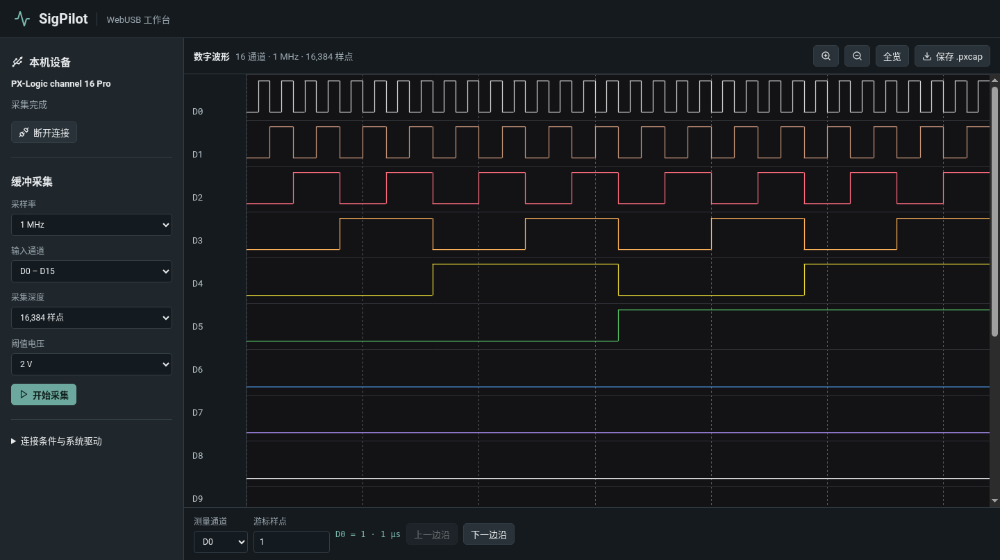

# WebUSB 本地工作台

把 PXLogic 接到运行浏览器的电脑。打开直连页面，点击「连接 USB 分析仪」，在浏览器的设备选择器中授权。设备就绪后选择采样率、通道、采集深度和输入阈值，点击「开始采集」。设备通信、采集数据和波形分析都留在本机。部署方只需提供静态文件。



浏览器可以缩放、拖动波形，右键某个样点可移动测量游标，也可以输入精确样点或跳到同一通道的上一条、下一条边沿。「保存 .pxcap」会下载当前采集。关闭标签页前请保存需要保留的数据。在 SigPilot 桌面端打开该文件即可继续协议解码。

## 从源码启动或部署

在仓库根目录运行以下命令，使用桌面 Chrome 或 Edge 打开终端显示的本机地址，默认 `http://127.0.0.1:1421/`。

```sh
pnpm install --frozen-lockfile
pnpm dev:webusb
```

部署时运行 `pnpm build:webusb`，将 `dist-webusb/` 中的全部文件发布到 HTTPS 静态站点。站点可以部署在子目录中，保留资源间的相对位置。要在本机使用已构建的文件，可运行 `python3 -m http.server 1421 --bind 127.0.0.1 --directory dist-webusb`。异地使用现场主机上的设备请使用[远程工作台](remote-workbench.md)。

## 各平台的 USB 条件

| 系统 | 连接前检查 |
| --- | --- |
| Windows | 设备所用接口 0 和 1 均需可由 WinUSB 访问。设备声明兼容 ID 时，Windows 可以自动匹配系统自带的 WinUSB。否则按厂商提供的驱动或签名 INF 完成绑定。重新枚举后检查运行态接口的驱动绑定。 |
| Linux | 用户需要 USB 设备节点读写权限。优先使用厂商提供的 udev 规则。修改规则后重新加载并重新插拔设备。 |
| macOS | 系统 USB 栈可访问空闲接口。退出已连接设备的 SigPilot、PXView 或其他占用程序。若有内核驱动占用，请检查厂商的接口配置。 |

在使用 systemd-logind 的 Linux 桌面上，管理员可在 `/etc/udev/rules.d/70-sigpilot-pxlogic.rules` 中使用下列规则，为当前本地登录用户授权。按实际 VID/PID 保留相应条目。

```udev
SUBSYSTEM=="usb", ENV{DEVTYPE}=="usb_device", ATTR{idVendor}=="1a86", ATTR{idProduct}=="5237", ATTR{manufacturer}=="PX*", TAG+="uaccess"
SUBSYSTEM=="usb", ENV{DEVTYPE}=="usb_device", ATTR{idVendor}=="16c0", ATTR{idProduct}=="05dc", ATTR{manufacturer}=="PX*", TAG+="uaccess"
```

运行 `sudo udevadm control --reload-rules` 后重新插拔。浏览器还需要对当前网站授予设备访问权限。如果多台设备的描述符和序列号完全相同，先只连接需要采集的那台。

浏览器对设备接口和驱动的要求见 [Chrome WebUSB 设备指南](https://developer.chrome.com/docs/capabilities/build-for-webusb) 和 [Microsoft WinUSB 安装说明](https://learn.microsoft.com/en-us/windows-hardware/drivers/usbcon/winusb-installation)。

## FPGA 与 MCU

设备连接后会核对 PX 厂商标识、USB 接口布局、固件版本和型号。运行固件版本 `0x56900028` 通过核验后，按顺序临时加载随站点分发的 reset 和 main FPGA bitfile。两份文件均会先核对 SHA-256。

已识别的 CH569 引导模式 `0x56900000` 会显示独立的 MCU 更新界面。选择厂商的 `SCI_LOGIC.bin`，再点击「写入固件并重启设备」才会执行持久写入。当前支持的镜像与仓库 `resources/firmware/SCI_LOGIC.bin` 相同，SHA-256 为 `da9b1e4912d3bc3757aa1d1ef71c4a19971bdc7ab66a6d31a9754fa82769ceaa`。写入期间保持供电。设备重新出现后，再次连接以读取实际运行版本。遇到未知版本，工作台会显示读到的版本并断开。

## 首版范围与验证

首版支持设备目录中两组 PXLogic USB 标识对应的数字缓冲采集。按照硬件型号可选连续的 4、8、16、32 路输入，100 kHz 至 100 MHz 的离散采样率，每次 1,024 至 262,144 个样点。每次缓冲采集先把信号记录到设备 DDR，再通过 USB 读回，完成后会停止；当前 WebUSB 工作台还不支持长时间循环或无间断流式采集。设置面板会明确提示这一限制。桌面端的 Demo 设备可以在 WebUSB 工作台中使用，无需连接设备或授权 USB。采样率与 USB 持续传输速率分别衡量。Kingst、长时间流采及浏览器内协议解码仍在后续计划中。

通过 TypeScript 与生产构建检查，并在 Chromium 中使用受控 USB 传输验证了共享工作台、无需 USB 授权的 Demo、设备识别、接口拒绝、FPGA 装载、DDR 命令顺序、错误应答、16 通道采集和 `.pxcap` 下载。在 1 MHz、16 通道的测试中，下载文件的 16,384 个样点逐个符合预期。共享工作台模拟测试入口为 `pnpm verify:webusb-shared`（需先执行 `pnpm build:webusb`）。旧版 USB 协议模拟入口为 `node tools/webusb-verify/run.mjs`。当前 Instabox 没有 USB 透传。三平台驱动绑定、真实固件启动和持续吞吐仍须实物验收。
